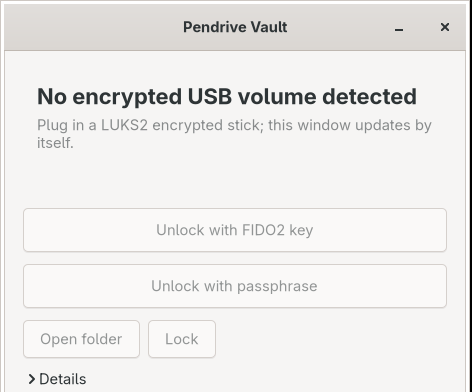

# Pendrive Vault

[](https://github.com/adilson0888/pendrive-vault/actions/workflows/ci.yml)
[](LICENSE)
[](#requirements)

A small GTK4 front-end for **LUKS2 USB volumes** that unlock either with a
**FIDO2 security key** (PIN + touch) or with a **passphrase**, and then open in
your normal file manager.

```text
  ┌────────────────────────────────────┐
  │  Pendrive Vault                    │
  │  ┌──────────────────────────────┐  │
  │  │ Locked                       │  │
  │  │ USB volume · 7.6 GiB ·       │  │
  │  │ security key detected        │  │
  │  └──────────────────────────────┘  │
  │   Unlock with FIDO2 key            │
  │   Unlock with passphrase           │
  │   [ Open folder ]      [ Lock ]    │
  └────────────────────────────────────┘
```

## Screenshots



*Idle state: with no volume attached the buttons stay disabled. Once a volume
labelled `PENDRIVE_VAULT` is plugged in, the card shows the device, its size and
whether a security key is detected, and the two unlock buttons become active.*

## Why this exists

Linux desktops cannot unlock a FIDO2-protected LUKS2 volume from a GUI.
GNOME Disks, KDE Disks and Dolphin all go through **udisks**, and udisks only
supports passphrases and key files — LUKS2 *tokens* (FIDO2, TPM2, PKCS#11) are
not implemented ([udisks#1317](https://github.com/storaged-project/udisks/issues/1317),
still open as of udisks 2.12).

So the only way to use a security key is the command line:

```bash
sudo cryptsetup open --token-type systemd-fido2 /dev/disk/by-uuid/… vault
sudo mount -o uid=$(id -u),gid=$(id -g) /dev/mapper/vault /mnt/vault
```

Pendrive Vault wraps exactly that — and nothing more. It is a thin, readable
GUI over the official `cryptsetup`/systemd token path, with a small polkit
helper that runs the privileged bits.

## Features

* **Pick your volume in the UI** — every encrypted USB stick shows up in a
  drop-down, labelled or not; the first time you use one, add it with a single
  click and it is remembered. No UUID is baked into the code.
* **Several volumes at once** — the drop-down appears whenever more than one
  is attached, and each keeps its own state.
* Unlock with a **FIDO2 key**: FIDO2 PIN + physical touch, via
  `systemd-fido2` LUKS2 tokens (hmac-secret is never re-implemented).
* Unlock with the **passphrase** keyslot, for when the key is not at hand.
* Clear **“👉 TOUCH YOUR SECURITY KEY NOW”** cue — the prompt cryptsetup
  normally hides inside a terminal.
* Mounts with your own `uid`/`gid` (`umask=077`) and opens the mounted folder
  in your file manager.
* One-click **Lock** (unmount + `cryptsetup close`, with stale-mapping
  recovery if the stick was yanked).
* Collapsible **Details** panel with cryptsetup's real output; the last run is
  also logged to `/run/pendrive-vault/last.log`.

## Requirements

| Component | Notes |
|---|---|
| Linux + systemd ≥ 248 | for `systemd-fido2` LUKS2 tokens |
| cryptsetup ≥ 2.7 | with `libcryptsetup-token-systemd-fido2.so` present |
| libfido2 | token communication |
| Python 3 + PyGObject + GTK 4 | the GUI |
| polkit | privileged helper (`pkexec`) |
| `fido2-token` | optional, only for the “key detected” indicator |

```bash
# Arch / CachyOS
sudo pacman -S python-gobject gtk4 cryptsetup libfido2 polkit

# Fedora
sudo dnf install python3-gobject gtk4 cryptsetup libfido2 polkit

# Debian / Ubuntu
sudo apt install python3-gi gir1.2-gtk-4.0 cryptsetup-bin libfido2-1 policykit-1
```

## Install

From a release (recommended — the tarball is checksummed):

```bash
curl -fsSLO https://github.com/adilson0888/pendrive-vault/releases/download/v0.1.0/pendrive-vault-0.1.0.tar.gz
curl -fsSLO https://github.com/adilson0888/pendrive-vault/releases/download/v0.1.0/SHA256SUMS
sha256sum -c SHA256SUMS --ignore-missing
tar xf pendrive-vault-0.1.0.tar.gz
sudo ./pendrive-vault-0.1.0/install.sh
```

Or from git, if you want to follow `main`:

```bash
git clone https://github.com/adilson0888/pendrive-vault.git
cd pendrive-vault
sudo ./install.sh
```

Then plug the stick in and launch the app: it lists every LUKS2 USB volume it
can see, and offers **Add this volume** for the one you want it to manage. The
choice is stored in `/etc/pendrive-vault.volumes`; nothing on the stick is
modified.

Two equivalent alternatives, if you prefer to set it up ahead of time:

```bash
# mark the volume itself (header metadata only, no re-encryption)
sudo cryptsetup config --label PENDRIVE_VAULT /dev/sdb2

# or pin one specific volume in the config
sudo ./install.sh --uuid <uuid>
```

Launch **Pendrive Vault** from the application menu, or run `pendrive-vault`.

Uninstall with `sudo ./uninstall.sh` (add `--purge` to drop the config).

## Preparing a volume

```bash
# 1. LUKS2 container (FAT32 inside, as an example)
sudo cryptsetup luksFormat --type luks2 --label PENDRIVE_VAULT /dev/sdb2
sudo cryptsetup open /dev/sdb2 vault
sudo mkfs.vfat -F 32 -n DATA /dev/mapper/vault
sudo cryptsetup close vault

# 2. enroll the FIDO2 key — the passphrase keyslot stays as your fallback
sudo systemd-cryptenroll --fido2-device=auto \
     --fido2-with-client-pin=yes --fido2-with-user-presence=yes /dev/sdb2

# 3. nothing else: the label is the marker, the app finds it
```

Check it worked:

```bash
sudo cryptsetup luksDump /dev/sdb2 | sed -n '/Tokens:/,$p'
# 0: systemd-fido2
```

> Keep the passphrase keyslot. It is what saves you when the key is lost,
> broken, or reset — a FIDO2 factory reset destroys the credential.

## Usage

| Action | What happens |
|---|---|
| **Unlock with FIDO2 key** | waits for the key if it isn't plugged in, asks for the FIDO2 PIN, shows `TOUCH YOUR SECURITY KEY NOW`, unlocks, mounts, opens the folder |
| **Unlock with passphrase** | asks for the passphrase, unlocks, mounts, opens the folder |
| **Lock** | unmounts and closes the mapping |
| **Details** | live cryptsetup output, for troubleshooting |

The state reloads itself every 1.5 s, so plugging a volume in or out needs no
interaction. With several attached, pick one in the drop-down; if the selected
volume has never been used with Pendrive Vault, the window offers
**Add this volume** instead of the unlock buttons, and remembers it from then
on (edit `/etc/pendrive-vault.volumes` as root to forget one).

The mount point is `/run/media/<user>/<filesystem-label>` (so a FAT32 label
`DATA` gives `/run/media/<user>/DATA`), falling back to `VAULT` when the
inner filesystem has no label.

## How it works

```text
pendrive-vault (GTK4, your user)
   │  pkexec                      ← only to list/validate/unlock/mount
   ▼
pendrive-vault-helper (root, polkit org.pendrivevault.unlock)
   ├─ discovery: lsblk → USB partitions with FSTYPE=crypto_LUKS
   │             + LUKS2 label == MARKER + not the running system disk
   ├─ passphrase:  cryptsetup open --key-file - <uuid> pv-<uuid8>
   └─ FIDO2:       pendrive-vault-token (pty driver)
                      └─ cryptsetup open --token-only <uuid> pv-<uuid8>
   └─ mount -o uid=…,gid=…,umask=077  →  /run/media/<user>/<label>
```

The GUI's own probe (unprivileged `lsblk`) is only used to notice plug/unplug
events; the helper is authoritative because reading LUKS2 labels needs root,
and it re-validates every target on every call.

The full story (pty driving, validation, mount naming, failure modes) is in
[docs/HOW-IT-WORKS.md](docs/HOW-IT-WORKS.md).

### Two implementation details worth knowing

**1. Why a pseudo-terminal driver is needed.**
`cryptsetup` prompts for the token PIN on a terminal and opens that prompt with
`TCSAFLUSH`, which *discards anything already queued*. Feeding the PIN through
a pipe (as `script(1)` would) makes cryptsetup read EOF and abort with
`Error reading passphrase from terminal.` — the PIN never reaches the token, so
the key never blinks. `src/pendrive-vault-token` runs cryptsetup on a real pty,
waits for the prompt, and only then writes the PIN, keeping the terminal
attached while cryptsetup waits for the touch.

**2. Why the passphrase read ignores `read`'s exit status.**
Bash's `read` returns non-zero at EOF even when it has assigned a value.
`IFS= read -r PASS || PASS=""` therefore silently truncates a passphrase that
arrives without a trailing newline, and cryptsetup reports
`Nothing to read on input.`

### Deliberately narrow privilege

The helper is not a generic root tool. It:

* reads a **root-owned** config (`/etc/pendrive-vault.conf`), so an unprivileged
  user cannot point it at another device;
* accepts only a UUID argument and then re-validates it: must be a block
  device, LUKS2, on a USB disk, not hold the running root filesystem, and be
  managed (label, `UUID=` pin, or added from the UI);
* offers only five actions (`list`, `adopt`, `unlock-fido2`,
  `unlock-passphrase`, `lock`);
* takes secrets on **stdin**, never on the command line.

## Configuration

`/etc/pendrive-vault.conf` (written by `install.sh`):

| Key | Meaning |
|---|---|
| `MARKER` | LUKS2 label that identifies managed volumes (default `PENDRIVE_VAULT`) |
| `UUID` | optional; restrict management to one specific volume |
| `MOUNT_NAME` | optional; force the folder name under `/run/media/<user>/` |

Volumes added from the UI are listed one per line in
`/etc/pendrive-vault.volumes` (root-owned). A volume is managed when it has the
`MARKER` label, is pinned by `UUID=`, or appears in that file.

## Security model

* Encryption is standard LUKS2 (`aes-xts-plain64`, argon2id) — this project
  adds no cryptography of its own.
* The FIDO2 PIN is passed to the key and never stored; the LUKS key is derived
  from the token's `hmac-secret` output.
* The **label is a selector, not an authenticator**. Anyone can label a LUKS2
  volume `PENDRIVE_VAULT`; the security still comes from the keyslots.
* The polkit policy uses `allow_active=yes`, so mounting does not require an
  admin password. Unlocking still requires the token (+PIN) or the passphrase.
  Change `allow_active` to `auth_admin_keep` in the installed policy if you
  prefer an explicit authorization prompt.
* The volume is mounted under `/run/media/<user>/…` with `umask=077`.

See [SECURITY.md](SECURITY.md) for the threat model and how to report issues.

## Limitations

* **Linux + systemd only.** The FIDO2 token format is systemd's; Windows and
  macOS cannot use it (the passphrase still works there, with any LUKS-capable
  tool).
* No boot-time/auto unlock: this is for plugging a stick in and unlocking on
  demand.
* The file browser is your desktop's, not built in.
* Tested on Arch/CachyOS with COSMIC, using FIDO2 keys that implement
  `hmac-secret`; other distributions and tokens should work but are untested.

## Troubleshooting

| Symptom | Likely cause |
|---|---|
| *No vault volume detected* | wrong/missing LUKS2 label — see `cryptsetup config --label`; or the volume is not on a USB disk |
| *The security key did not unlock the volume* | wrong PIN, or the key was not touched within ~30 s |
| *security key not detected* | key not plugged in, or `fido2-token -L` cannot see it |
| *Wrong passphrase* | keyslot mismatch — verify with `cryptsetup open --test-passphrase <device>` |
| *The volume is already unlocked* | a mapping exists; press **Lock**, or `cryptsetup close pv-<uuid8>` |
| *That device is not a Pendrive Vault volume* | the helper refused it: label mismatch, not USB, or it holds `/` |

The log at `/run/pendrive-vault/last.log` contains the exact cryptsetup output of the
last operation.

## Testing

```bash
make test     # no hardware, no root needed for the driver tests
make lint     # shellcheck + syntax checks
make check    # both
```

The suite verifies the parts that are easy to get wrong: that the pty driver
delivers the PIN only after the prompt, masks it in its output, disables
terminal echo, waits for the child and propagates its exit code; and that the
privileged helper rejects unknown actions, malformed UUIDs and unknown volumes
with the documented exit codes. CI runs the same tests on every push.

## Packaging

* `install.sh` understands `DESTDIR` and `PREFIX`, so it can stage files into a
  package root: `DESTDIR="$pkgdir" PREFIX=/usr ./install.sh`.
* Each release ships a checksummed source tarball plus `SHA256SUMS`.
* An AUR recipe is kept in
  [packaging/pendrive-vault-git/PKGBUILD](packaging/pendrive-vault-git/PKGBUILD)
  (not submitted to the AUR yet).
* `deb`/`rpm` recipes are welcome — the only thing that must happen
  system-wide is installing the two executables under `libexec`, the polkit
  policy, the desktop entry and the default config.

## Changelog

See [CHANGELOG.md](CHANGELOG.md).

## FAQ

### Is there an AppImage, Flatpak or Snap?

No, deliberately. Unlocking a LUKS2 volume is a system operation: the helper
must run as root through `pkexec`, polkit only reads action files from
`/usr/share/polkit-1/actions`, and the FIDO2 path is driven by the host's
`cryptsetup` token handler. An AppImage mounts at a random `/tmp/.mount_*`
path (so `pkexec` cannot match it) and is `nosuid`; Flatpak and Snap cannot
provide the root helper at all. Bundling cryptsetup and libfido2 would also
freeze the very crypto code that should come from your distribution.

`install.sh` is three files, a polkit policy and a desktop entry — it already
works on any distribution that has `cryptsetup`, `libfido2`, GTK4 and PyGObject.
Distro packages are welcome; see [Packaging](#packaging).

### Do I have to relabel my volume?

Yes, once, and only the LUKS2 header is touched — no re-encryption:

```bash
sudo cryptsetup config --label PENDRIVE_VAULT /dev/sdX2
```

Without a label the app will not offer the volume, by design: it never guesses
which encrypted device is "its".

### Will this work without a FIDO2 key?

Yes. The passphrase keyslot is independent, and the app offers both paths. If
you only ever use the passphrase, skip `systemd-cryptenroll` entirely.

### Is my PIN or passphrase stored anywhere?

No. Both go to the helper on stdin, are passed to `cryptsetup`, and are never
written to disk, argv or the environment. The FIDO2 PIN is additionally masked
in anything the pty driver prints. See [SECURITY.md](SECURITY.md).

## Contributing

Issues and pull requests are welcome. The code is intentionally small: one GUI
file, one pty driver, one shell helper. Keep the privileged surface narrow and
the GUI free of crypto.

Run `make check` before opening a pull request.

## License

GPL-3.0-or-later — see [LICENSE](LICENSE).
